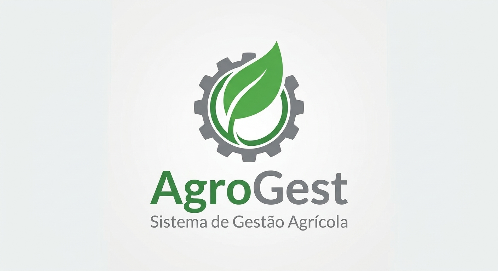
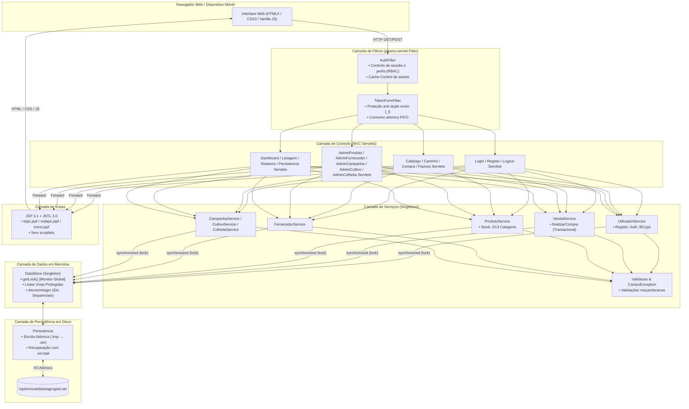

<p align="center">
  
</p>

<h1 align="center">AgroGest — Sistema de Gestão Agrícola</h1>

<p align="center">
  <strong>Plataforma Web de Gestão Agrícola e Comércio Eletrónico para Produtores de Nampula</strong><br>
  Trabalho Prático de Sistemas Distribuídos — Licenciatura em Engenharia Informática<br>
  <strong>ISCTEM — Instituto Superior de Ciências e Tecnologias de Moçambique (2026)</strong>
</p>

<p align="center">
  
  
  
  
  
  
</p>

---

## 📋 Índice

1. [Visão Geral](#-visão-geral)
2. [Stack Tecnológico](#-stack-tecnológico)
3. [Arquitetura do Sistema](#-arquitetura-do-sistema)
   - [Diagrama de Camadas](#diagrama-de-camadas)
   - [Concorrência e Monitor Único (Lock)](#concorrência-e-monitor-único-lock)
   - [Fluxo Transacional de Compra (finalizarCompra)](#fluxo-transacional-de-compra-finalizarcompra)
   - [Persistência Atómica em Disco](#persistência-atómica-em-disco)
   - [Filtros de Segurança e Ciclo de Vida](#filtros-de-segurança-e-ciclo-de-vida)
4. [Credenciais de Teste e Perfis de Acesso](#-credenciais-de-teste-e-perfis-de-acesso)
5. [Regras de Negócio (RN01 – RN06)](#-regras-de-negócio-rn01--rn06)
6. [Decisões Técnicas e de Negócio (D1 – D19)](#-decisões-técnicas-e-de-negócio-d1--d19)
7. [Rotas Principais](#-rotas-principais)
8. [Compilação e Execução de Testes](#-compilação-e-execução-de-testes)
9. [Instalação, Deploy e Serviço Systemd](#-instalação-deploy-e-serviço-systemd)
10. [Documentação e Manual](#-documentação-e-manual)
11. [Autores](#-autores)

---

## 🌾 Visão Geral

O **AgroGest** é uma aplicação web distribuída concebida para modernizar a gestão operacional e a venda direta de insumos, equipamentos e colheitas agrícolas de produtores da província de Nampula, Moçambique.

A aplicação foi concebida de acordo com os requisitos rigorosos de Sistemas Distribuídos:
- **Sem base de dados relacional externa:** Toda a informação reside em estruturas de dados em memória organizadas no repositório singleton (`DataStore`), persistidas em disco por serialização nativa Java (`Persistencia`).
- **Arquitetura MVC pura em Jakarta EE 10:** Separação estrita de responsabilidades entre Filtros de requisição, Controladores (Servlets 6.0), Serviços de negócio transacionais, Camada de dados sincronizada e Apresentação (JSP 3.1 + JSTL + CSS responsivo sem frameworks pesadas).
- **Concorrência segura multithread:** Suporte a múltiplos clientes em simultâneo através de um monitor de sincronização único reentrante (`getLock()`), garantindo transações atómicas (tudo-ou-nada), proteção rigorosa contra vendas acima do stock e prevenção de submissões concorrentes duplicadas.

---

## 🛠 Stack Tecnológico

| Componente | Tecnologia | Finalidade / Justificação |
|---|---|---|
| **Linguagem** | Java 17 LTS (OpenJDK 17) | Tipagem estática robusta, concorrência nativa, data/hora moderna (`java.time`). |
| **Servidor de Aplicações** | Apache Tomcat 10.1 | Contentor de Servlets compatível com Jakarta EE 10 (`jakarta.*`). |
| **API de Servlets** | Jakarta Servlet 6.0 | Roteamento HTTP, sessões e controlo do ciclo de vida das requisições. |
| **Apresentação** | Jakarta Pages 3.1 (JSP) + JSTL 3.0 | Visualização sem *scriptlets* (`<% %>`), renderização com tags `c:`, `fmt:`, `fn:`. |
| **Segurança & Criptografia** | jBCrypt 0.4 | Hashing salgado unidirecional para armazenamento seguro de palavras-passe. |
| **Gestão de Build** | Apache Maven 3.x | Automação de compilação, testes e empacotamento em ficheiro Web Application Archive (`agrogest.war`). |
| **Testes Automatizados** | JUnit 5 (Jupiter 5.10.2) | 112 testes unitários e de integração multithread cobrindo serviços e filtros. |
| **Estilos & UI** | CSS3 Nativo + SVG Inline | Variáveis CSS semânticas, tipografia *self-hosted* (Inter), sprites SVG Lucide e grelhas responsivas (compatível a 360 px e A4). |
| **Scripting Cliente** | Vanilla JavaScript | Manipulação assíncrona leve: fecho de dropdowns, validação de formulários, confirmações em `<dialog>` e toasts. |
| **Sistema Operativo / Produção** | Linux com Systemd | Gestão de processo como daemon (`tomcat.service`), isolamento de utilizador `tomcat:tomcat` na porta `8081`. |

---

## 🏛 Arquitetura do Sistema

### Diagrama de Camadas



### Concorrência e Monitor Único (Lock)

O sistema gere todas as alterações de dados através de um monitor exclusivo:
```java
synchronized (DataStore.getInstance().getLock()) {
    // Operações atómicas de leitura/escrita em memória
}
```
- **Um único objeto de lock:** Impede *race conditions* entre utilizadores a comprar, administradores a gerir produtos ou processos de persistência em simultâneo.
- **Cópias defensivas:** As consultas de listagem retornam instâncias novas (`new ArrayList<>(...)`), impedindo modificações concorrentes durante a iteração nas páginas JSP.
- **Identificadores atómicos:** Chaves primárias geradas via instâncias de `AtomicInteger`, assegurando IDs estritamente sequenciais e sem colisões mesmo sob concorrência intensa.

### Fluxo Transacional de Compra (`finalizarCompra`)

A finalização da encomenda em `VendaService.finalizarCompra(Utilizador cliente, Map<Integer, Double> itens)` implementa o padrão de transação atómica:

1. **Validação de entrada:** Confirmação de que o carrinho contém itens válidos e utilizador autenticado.
2. **Entrada no Monitor:** Bloqueio do lock global do `DataStore`.
3. **Verificação de Stock Total (RN01 & RN02):** Itera sobre todos os itens da compra e confirma se a quantidade solicitada existe em stock para cada produto. Se um único produto não tiver stock suficiente, é lançada uma `NegocioException` descritiva e **nenhum produto sofre alteração**.
4. **Débito de Stock:** Estando todos os artigos disponíveis, o stock de cada produto é decrementado em memória.
5. **Cálculo Monetário de Alta Precisão:**
   - Preços unitários e subtotais calculados em `BigDecimal` com arredondamento `RoundingMode.HALF_UP` (2 casas decimais).
   - Cálculo de IVA à taxa moçambicana de 16%: `iva = subtotal.multiply(new BigDecimal("0.16"))`.
   - `total = subtotal.add(iva)`.
6. **Emissão de Fatura Imutável:**
   - Atribuição de número sequencial: `FT-{ano}-{id}` (ex.: `FT-2026-1`).
   - Criação de snapshot dos itens em instâncias imutáveis de `VendaItem` (preservando o nome, preço e unidade no instante da venda, mesmo que o produto venha a ser modificado ou removido posteriormente, conforme a regra D7).
   - Snapshot dos dados de contacto e entrega do cliente na entidade `Venda`.
7. **Registo:** Adição da venda à lista do `DataStore` e libertação do lock.

### Persistência Atómica em Disco

Gerida pela classe `mz.agrogest.repo.Persistencia`:
- **Localização:** `/opt/tomcat/data/agrogest.ser` (resolvido dinamicamente via `${catalina.base}/data/agrogest.ser`).
- **Gravação Segura:** Para prevenir corrupção em caso de queda de energia ou paragem do servidor a meio da escrita, os dados são primeiramente serializados para um ficheiro temporário (`agrogest.ser.tmp`) e posteriormente movidos para o ficheiro definitivo através de uma operação atómica do sistema de ficheiros (`StandardCopyOption.ATOMIC_MOVE` ou `REPLACE_EXISTING`).
- **Tolerância a Falhas:** Caso o ficheiro de dados seja encontrado corrompido durante o arranque do Tomcat, este é preservado como cópia forense (`agrogest.ser.bak`) e a aplicação arranca com memória limpa, garantindo disponibilidade de serviço sem interrupção fatal.
- **Ciclo de Vida:** O `ContextListener` restaura automaticamente os dados no arranque da aplicação e grava o estado completo na terminação graciosa do contentor.

### Filtros de Segurança e Ciclo de Vida

- **`AuthFilter` (`/*`):**
  - Mapeado em toda a aplicação com verificação de rotas públicas (`/`, `/login`, `/registo`, `/logout`, `/css/*`, `/assets/*`).
  - Protege rotas de clientes (`/catalogo`, `/carrinho/*`, `/compra`, `/factura`, `/minhas-compras`), redirecionando acessos anónimos para `/login` (RN05).
  - Bloqueia estritamente acessos de clientes à área de administração (`/admin/*`), devolvendo `HTTP 403 Forbidden` (RN04).
  - Restringe o acesso a faturas em `/factura?id=X`: clientes só podem visualizar as suas próprias faturas; o administrador pode consultar qualquer fatura (RN03).
  - Aplica cabeçalhos de *caching* (`Cache-Control: public, max-age=86400`) para recursos estáticos (`/assets/*`, `/css/*`).
- **`TokenFormFilter` (`/*`):**
  - Defesa robusta contra cliques múltiplos e reenvio inadvertido de formulários POST.
  - Nas requisições GET, gera um token criptográfico único (`UUID`), armazena-o num conjunto com limite FIFO de 50 tokens na sessão e disponibiliza-o no request sob o atributo `tokenForm`.
  - Nas requisições POST (exceto `/logout`), consome atomicamente o parâmetro `_t`. Se o token for inexistente ou já tiver sido consumido, rejeita a execução do servlet e redireciona para a página anterior com mensagem flash de aviso, eliminando duplicações concorrentes de faturas e produtos.

---

## 🔑 Credenciais de Teste e Perfis de Acesso

O sistema dispõe de dois perfis de utilizador (`mz.agrogest.model.Perfil`):

### 1. Administrador do Sistema (`ADMIN`)
Criado automaticamente na inicialização da aplicação (conforme D11) caso não exista no repositório:
- **Email:** `admin@agro.mz`
- **Palavra-passe:** `admin234`
- **Permissões:** Acesso completo a `/admin/dashboard`, gestão de produtos, reposição de stock, fornecedores, campanhas agrícolas, parcelas de cultivo, registo de colheitas, 5 listagens ordenáveis, 4 relatórios analíticos, persistência manual e consulta de todas as faturas emitidas.

### 2. Clientes de Teste (`CLIENTE`)
Carregados automaticamente através de `mz.agrogest.util.DadosDemo` no primeiro arranque limpo (sem ficheiro `.ser` prévio):
- **Cliente Principal (Demo do Enunciado):**
  - **Email:** `joao@teste.mz`
  - **Palavra-passe:** `1234`
  - **Nome:** João Açúcar (teste UTF-8 moçambicano)
- **Outros Clientes de Demonstração (com histórico de compras):**
  - `ana@teste.mz` / `1234` (Ana Bila — compras registadas)
  - `carlos@teste.mz` / `1234` (Carlos Mondlane — compras registadas)
  - `maria@teste.mz` / `1234` (Maria Cossa — compras registadas)
  - `pedro@teste.mz` / `1234` (Pedro Sitoe — cliente sem compras, útil para testar o relatório correspondente)
- **Registo Público:** Qualquer visitante anónimo pode auto-registar-se em `/registo`, atribuindo-se automaticamente o perfil `CLIENTE`.

---

## 📜 Regras de Negócio (RN01 – RN06)

| Código | Descrição da Regra | Implementação no AgroGest |
|---|---|---|
| **RN01** | **Não vender mais que o stock** | O `VendaService` verifica rigorosamente a quantidade disponível de cada produto dentro do monitor sincronizado antes de autorizar qualquer decremento. |
| **RN02** | **Venda atómica (tudo ou nada)** | Transação atómica integral: caso um único item do carrinho não disponha de stock suficiente, a venda é imediatamente abortada sem que nenhum outro produto sofra débito de stock. |
| **RN03** | **Privacidade de Faturas** | O `FacturaServlet` valida se o cliente autenticado é o titular da venda (`venda.getClienteId() == utilizador.getId()`) ou se possui perfil `ADMIN`. Tentativas de acesso a faturas de terceiros resultam em `HTTP 403 Forbidden`. |
| **RN04** | **Restrição de Acesso Administrativo** | Todas as rotas sob `/admin/*` são intercetadas pelo `AuthFilter`. Utilizadores não autenticados são encaminhados para `/login`; utilizadores com perfil `CLIENTE` recebem `HTTP 403 Forbidden`. |
| **RN05** | **Sessão Obrigatória para Loja** | As rotas `/catalogo`, `/carrinho/*`, `/compra`, `/factura` e `/minhas-compras` exigem autenticação ativa. Acessos anónimos são redirecionados pelo `AuthFilter` para `/login`. |
| **RN06** | **IDs Sequenciais e Únicos** | Os identificadores de Utilizadores, Fornecedores, Produtos, Campanhas, Cultivos, Colheitas e Vendas são gerados através de instâncias de `AtomicInteger` no `DataStore`, mantendo a sequência mesmo após reinício do servidor. |

---

## ⚖️ Decisões Técnicas e de Negócio (D1 – D19)

- **D1 (Campo Ativo):** O campo booleano `ativo` da entidade `Utilizador` foi preservado no modelo para conformidade contratual, sem regras de bloqueio adicionais.
- **D2 (Formato de Fatura):** Numeração oficial de faturação padronizada como `FT-{ano}-{id}` (ex.: `FT-2026-1`).
- **D3 / D4 (Cálculo Financeiro e IVA):** Valores monetários geridos exclusivamente com `BigDecimal` a 2 casas decimais e arredondamento `HALF_UP`. Preços de catálogo e unitários são registados sem IVA; a taxa de IVA moçambicana de 16% é apurada no checkout sobre o subtotal.
- **D5 (Ciclo de Vida de Campanhas):** Uma campanha com estado fechada (`aberta == false`) rejeita terminantemente novos cultivos e o registo de novas colheitas.
- **D6 (Integridade de Fornecedores):** Um fornecedor com produtos associados no catálogo não pode ser removido (lança exceção de negócio explicativa).
- **D7 (Integridade Histórica de Vendas):** A eventual remoção de um produto do catálogo não corrompe nem afeta faturas passadas, pois a `Venda` preserva cópias imutáveis em `VendaItem`.
- **D8 (Métricas dos Relatórios):** No módulo analítico, "Volume de Compras" corresponde ao valor total faturado em Meticais (MT), e "Mais Assíduos" corresponde ao número absoluto de compras efetuadas.
- **D9 (Listagens Somente de Leitura):** As grelhas sob `/admin/listagens/*` são estritamente orientadas à consulta, ordenação e auditoria tabular.
- **D10 (Persistência em Disco e Ação de Eliminar):** O ficheiro de dados reside em `${catalina.base}/data/agrogest.ser`. A funcionalidade "Eliminar ficheiro" apaga unicamente o ficheiro físico em disco; os dados em memória permanecem ativos até que o processo do Tomcat seja terminado.
- **D11 (Segurança de Credenciais):** Armazenamento de palavras-passe cifradas com BCrypt. O utilizador administrador inicial é garantido no arranque.
- **D12 (Integridade de Serialização):** Qualquer alteração estrutural no pacote `mz.agrogest.model` invalida ficheiros `.ser` prévios, exigindo a respetiva remoção.
- **D13 (Compatibilidade Categoria ↔ Fornecedor):** Mapeamento estrito entre a categoria do produto e o tipo de fornecedor (`SEMENTE` → `SEMENTES`, `FERTILIZANTE` → `FERTILIZANTES`, `MAQUINARIA` e `FERRAMENTA` → `MAQUINARIA`). O `ProdutoService` valida esta coerência e a interface web filtra os fornecedores disponíveis.
- **D14 (Unicidade de Nomes):** Validação de unicidade (*case-insensitive*) dentro do monitor de concorrência para fornecedores, produtos (por nome + fornecedor) e campanhas agrícolas.
- **D15 (Data de Validade de Produtos):** A data de validade não pode ser anterior à data presente na criação. Produtos com validade expirada exibem badge visual de aviso sem impedir a venda de stock remanescente.
- **D16 (Unidades de Medida Fixadas):** Restrição estrita às 5 unidades autorizadas pelo negócio: `kg`, `saco`, `litro`, `tonelada`, `unidade`.
- **D17 (Formatos e Contactos Moçambicanos):** Validação de números de telefone de Moçambique com prefixo nacional opcional (`+258`), aceitando redes móveis (82/83 Tmcel, 84/85 Vodacom, 86/87 Movitel, 88) e linhas fixas (2X). Normalização automática no formato `+258 84 123 4567`. Validação das 11 províncias de Moçambique.
- **D18 (Erros Associados a Campos):** Utilização da classe `CampoException` (subclasse de `NegocioException`) para assinalar o campo causador da falha, permitindo ao frontend realçar o *input* com contorno de erro, ícone e mensagem debaixo do campo.
- **D19 (Prevenção Anti Duplo Envio):** Mecanismo de tokens de formulário de uso único `_t` gerados na sessão e consumidos atomicamente pelo filtro `TokenFormFilter` em todas as submissões POST.

---

## 🗺 Rotas Principais

### Área Pública e Autenticação
| Método | Rota | Controlador | Descrição |
|---|---|---|---|
| `GET` | `/` | `HomeServlet` | Redirecionamento inteligente: anónimo → `/login`, cliente → `/catalogo`, admin → `/admin/dashboard`. |
| `GET` / `POST` | `/login` | `LoginServlet` | Autenticação de utilizadores com renovação de sessão (`changeSessionId`). |
| `GET` / `POST` | `/registo` | `RegistoServlet` | Auto-registo público de novos clientes com validação de campos moçambicanos. |
| `GET` / `POST` | `/logout` | `LogoutServlet` | Encerramento de sessão com invalidação imediata. |

### Área do Cliente (Exige Autenticação)
| Método | Rota | Controlador | Descrição |
|---|---|---|---|
| `GET` | `/catalogo` | `CatalogoServlet` | Vitrine de produtos com filtro dinâmico por categoria e pesquisa. |
| `GET` | `/carrinho` | `CarrinhoServlet` | Visualização detalhada do carrinho com subtotais, IVA e total. |
| `POST` | `/carrinho/adicionar` | `CarrinhoServlet` | Adição de produto ao carrinho em sessão. |
| `POST` | `/carrinho/atualizar` | `CarrinhoServlet` | Atualização da quantidade de um item no carrinho. |
| `POST` | `/carrinho/remover` | `CarrinhoServlet` | Remoção de uma linha do carrinho. |
| `POST` | `/carrinho/esvaziar` | `CarrinhoServlet` | Esvaziamento completo do carrinho de compras. |
| `GET` / `POST` | `/compra` | `CompraServlet` | Confirmação de morada e fecho transacional da encomenda. |
| `GET` | `/factura?id=...` | `FacturaServlet` | Emissão e impressão da fatura em formato A4 (`window.print()`). |
| `GET` | `/minhas-compras` | `MinhasComprasServlet` | Histórico de compras e faturas do cliente autenticado. |

### Área Administrativa (`/admin/*` — Exclusiva para `ADMIN`)
| Método | Rota | Controlador | Descrição |
|---|---|---|---|
| `GET` | `/admin/dashboard` | `DashboardServlet` | Visão executiva com cartões de contagem e indicadores do sistema. |
| `GET` / `POST` | `/admin/produtos/*` | `AdminProdutoServlet` | Gestão de produtos, reposição de stock e galeria de fotografias. |
| `GET` / `POST` | `/admin/fornecedores/*` | `AdminFornecedorServlet` | Registo e consulta de fornecedores por província e tipo. |
| `GET` / `POST` | `/admin/campanhas/*` | `AdminCampanhaServlet` | Gestão de campanhas agrícolas (abrir, fechar, remover). |
| `GET` / `POST` | `/admin/cultivos/*` | `AdminCultivoServlet` | Gestão de parcelas de cultivo associadas a campanhas abertas. |
| `GET` / `POST` | `/admin/colheitas/*` | `AdminColheitaServlet` | Registo de colheitas com cálculo automático de rendimento e valor total. |
| `GET` | `/admin/listagens/*` | `ListagemServlet` | Listagens ordenáveis de produtos, armazém, clientes e compras. |
| `GET` | `/admin/relatorios/*` | `RelatorioServlet` | Relatórios analíticos de clientes, assíduos, compras e sem compras. |
| `GET` / `POST` | `/admin/persistencia/*`| `PersistenciaServlet` | Gestão manual de gravação imediata e limpeza do ficheiro `.ser`. |

---

## 🧪 Compilação e Execução de Testes

### Pré-requisitos
- **Java Development Kit (JDK):** Versão 17 LTS instalada.
- **Apache Maven:** Versão 3.8 ou superior.

### Comandos de Verificação e Testes

1. **Executar a suite completa de testes unitários e de integração:**
   ```bash
   mvn clean test
   ```
   > Executa **112 testes automatizados** em JUnit 5, cobrindo:
   > - Validações moçambicanas de nomes, contactos, preços e unidades (`ValidacaoTest`);
   > - Concorrência, atomicidade e proteção anti duplo envio no filtro (`TokenFormFilterTest`);
   > - Carregamento de dados de demonstração sem duplicação (`DadosDemoTest`);
   > - Serviços de negócio e integridade transacional de vendas (`VendaServiceTest`, `CampanhaServiceTest`, `CultivoServiceTest`, `ColheitaServiceTest`, `UtilizadorServiceTest`).

2. **Compilar e gerar o pacote Web Application Archive (WAR):**
   ```bash
   mvn clean package
   ```
   O pacote compilado e pronto para produção é gerado no caminho:
   ```text
   target/agrogest.war
   ```

---

## 🚀 Instalação, Deploy e Serviço Systemd

Para colocar o AgroGest em execução num servidor Linux com Apache Tomcat 10.1 na porta **8081** sob o contexto `/agrogest`:

### 1. Configuração do Tomcat e do Sistema
1. Instalar o Apache Tomcat 10.1 no diretório `/opt/tomcat`.
2. Criar o utilizador e grupo dedicados de sistema:
   ```bash
   sudo useradd -r -U -d /opt/tomcat -s /usr/sbin/nologin tomcat
   sudo chown -R tomcat:tomcat /opt/tomcat
   sudo chmod +x /opt/tomcat/bin/*.sh
   ```
3. Criar o diretório de dados para a persistência serializada com permissões adequadas:
   ```bash
   sudo mkdir -p /opt/tomcat/data
   sudo chown -R tomcat:tomcat /opt/tomcat/data
   ```

### 2. Configurar a Porta 8081 no Tomcat
Editar o ficheiro `/opt/tomcat/conf/server.xml` e alterar a porta do conector HTTP para `8081`:
```xml
<Connector port="8081" protocol="HTTP/1.1"
           connectionTimeout="20000"
           redirectPort="8443"
           maxParameterCount="1000" />
```

### 3. Criar a Unidade de Serviço Systemd
Criar o ficheiro `/etc/systemd/system/tomcat.service` (ou utilizar o modelo existente em `deploy/tomcat.service`):
```ini
[Unit]
Description=Apache Tomcat 10.1 (AgroGest)
After=network.target

[Service]
Type=forking
User=tomcat
Group=tomcat
Environment=JAVA_HOME=/usr/lib/jvm/java-17-openjdk-amd64
Environment=CATALINA_HOME=/opt/tomcat
Environment=CATALINA_BASE=/opt/tomcat
Environment=CATALINA_PID=/opt/tomcat/temp/tomcat.pid
PIDFile=/opt/tomcat/temp/tomcat.pid
ExecStart=/opt/tomcat/bin/startup.sh
ExecStop=/opt/tomcat/bin/shutdown.sh 30
TimeoutStopSec=60
Restart=on-failure
RestartSec=5
SuccessExitStatus=143

[Install]
WantedBy=multi-user.target
```
> [!NOTE]
> A diretiva `TimeoutStopSec=60` assegura tempo suficiente para que o Tomcat execute o gancho de terminação do `ContextListener`, persistindo atomicamente todos os dados em memória para `/opt/tomcat/data/agrogest.ser` antes de o processo ser encerrado.

### 4. Ativar e Iniciar o Serviço
```bash
sudo systemctl daemon-reload
sudo systemctl enable --now tomcat
sudo systemctl status tomcat
```

### 5. Fazer Deploy do Pacote `agrogest.war`
Após gerar o ficheiro através de `mvn clean package`:
```bash
# Copiar o ficheiro para o diretório de aplicações do Tomcat
sudo cp target/agrogest.war /opt/tomcat/webapps/agrogest.war
sudo chown tomcat:tomcat /opt/tomcat/webapps/agrogest.war

# Reiniciar o serviço para assegurar um arranque limpo
sudo systemctl restart tomcat
```

### 6. Aceder à Aplicação
Aceder no navegador web a:
```text
http://localhost:8081/agrogest/
```
Se a firewall do servidor estiver ativa (`ufw`):
```bash
sudo ufw allow 8081/tcp
```

### 7. Verificação de Registos e Persistência
- **Consultar registos em tempo real:**
  ```bash
  journalctl -u tomcat -f
  # ou
  tail -f /opt/tomcat/logs/catalina.out
  ```
- **Inspecionar a persistência de dados:**
  ```bash
  ls -lh /opt/tomcat/data/agrogest.ser
  ```

---

## 📚 Documentação e Manual

- **Manual de Utilização em PDF:** Consulte a pasta [`docs/manual/`](docs/manual/) para aceder ao guia ilustrado para clientes e administradores com o passo a passo completo da plataforma.
- **Histórico e Planeamento:** O planeamento das sessões de trabalho e o progresso técnico encontram-se documentados em [`docs/PLANO_SESSOES.md`](docs/PLANO_SESSOES.md) e [`docs/PROGRESS.md`](docs/PROGRESS.md).

---

## 👥 Autores

Trabalho prático desenvolvido para a unidade curricular de **Sistemas Distribuídos**, Licenciatura em Engenharia Informática, **ISCTEM** (Maputo, Moçambique):

- **[Ayko Sambo](https://github.com/CS15A)**
- **[Naira Ornilo](https://github.com/nairaornilo)**
- **[Hélder Vuca Júnior](https://github.com/HTAJnr/)**

---
<p align="center">
  <em>AgroGest — Potenciando o desenvolvimento agrário de Moçambique com sistemas distribuídos eficientes e seguros.</em>
</p>
